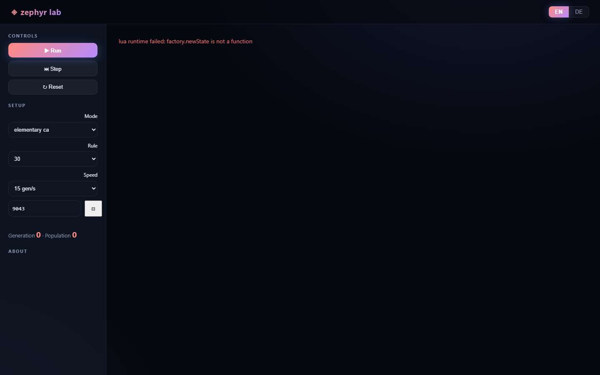
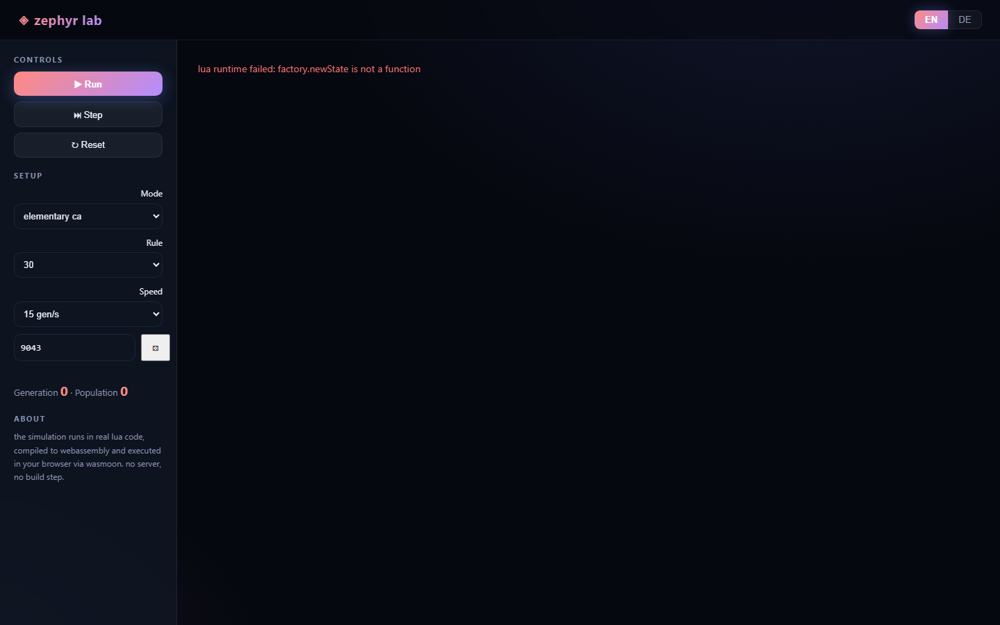
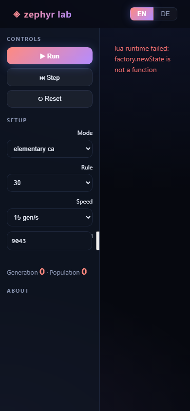

# Zephyr Lab — Lua Automata

A cellular automaton explorer written in real Lua: elementary CA rules and Conway's Game of Life compiled to WebAssembly via wasmoon, rendered on canvas at up to 60 generations per second.

<div align="center">


-orange)


**[Live Demo](https://ruslanfridenli.github.io/zephyr-lab/)** · **[Deutsch ↓](#-deutsch)**

</div>

---

## Screenshots







## Features

- Simulation written in real Lua (wasmoon → WebAssembly)
- Elementary CA rules 30/90/110/150 + Game of Life
- Up to 60 generations per second
- Seeded, reproducible universes
- Runs fully client-side, no server
- English/German interface

## Local development

```bash
git clone https://github.com/ruslanfridenli/zephyr-lab.git
cd zephyr-lab
# open index.html in a browser, or serve statically:
npx serve .
```

No build step, no dependencies — pure static site.

---

## 🇩🇪 Deutsch

### Zephyr Lab — Lua-Automaten

Ein in echtem Lua geschriebener Zellulärautomat-Explorer: elementare CA-Regeln und Conways Game of Life, kompiliert zu WebAssembly via wasmoon und auf Canvas mit bis zu 60 Generationen pro Sekunde gerendert.

### Funktionen

- Simulation in echtem Lua (wasmoon → WebAssembly)
- Elementare CA-Regeln 30/90/110/150 + Game of Life
- Bis zu 60 Generationen pro Sekunde
- Gesperrte, reproduzierbare Universen
- Läuft vollständig clientseitig
- Englische/deutsche Oberfläche

### Lokale Entwicklung

```bash
git clone https://github.com/ruslanfridenli/zephyr-lab.git
cd zephyr-lab
npx serve .
```

Reine statische Seite — kein Build-Schritt, keine Abhängigkeiten.

---

## ☕ Support / Unterstützen

Wenn dir diese Website beim Lernen hilft, würde mir eine Spende sehr viel bedeuten und dabei helfen, sie weiterzuentwickeln. Alternativ kannst du das Projekt mit einem Stern im github repo unterstützen. Vielen Dank!

- Solana: `zQpgZ6nGigww7vYpz3Qqxb1BT44kqS567vFaLTeHagS`
- Ethereum: `0x9c4fE1B2e9a1A9c22312c8296BB088Ca0e8F1B4e`
- Bitcoin: `bc1p2jltk9ya9kyzv35d8kxn7mmg9jqkx66cqtgzqwe75zlr4v9jk4hsv468q7`

---

Made with care. Feedback welcome via issues.
